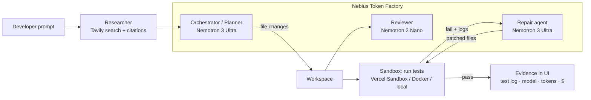

# CodingAgent: a coding agent that proves its code works, on NVIDIA Nemotron + Nebius Token Factory

[](LICENSE)
**Track:** Coding and Agentic Engineering · **NVIDIA x Nebius Global AI Hackathon**

> Most coding agents hand you a diff and hope. CodingAgent **writes the code, runs the tests in a sandbox, and repairs failures with Nemotron 3 Ultra until they pass**. Every answer comes with evidence: the test log, the model that made each call, and its cost.

- **Live demo:** `TODO: https://<deployment-url>/?demo=1`
- **Demo video (≤3 min):** `TODO: https://youtu.be/<id>`

## Why

Developers, especially small teams and students paying in INR, can't afford to babysit an agent that writes code it never ran, or one that sends every trivial call to an expensive frontier model. CodingAgent addresses both problems:

1. **Verification.** Code is executed and tested in an isolated sandbox before you trust it.
2. **Cost-aware routing.** NVIDIA Nemotron tiers on Nebius Token Factory: **Ultra** for reasoning (planning, repairing failing tests), **Super** for implementation, **Nano** for fast everyday calls (review, triage). Per-step model and USD cost appear in the UI.

## How it works



| Step | Model / tool | Why |
|---|---|---|
| Research | Tavily `/search` | Fresh docs, API and error lookups; sources shown as citations |
| Plan + implement | `nvidia/Nemotron-3-Ultra-550b-a55b` | Multi-file reasoning |
| Implementer / architect role | `nvidia/nemotron-3-super-120b-a12b` | Good code quality at lower cost |
| Review, triage | `nvidia/NVIDIA-Nemotron-3-Nano-30B-A3B` | Fast and cheap ($0.06 / $0.24 per 1M tokens) |
| Repair loop | `nvidia/Nemotron-3-Ultra-550b-a55b` | Diagnoses test output, patches source; capped at `REPAIR_MAX_ATTEMPTS` |

The write → run → test → repair loop (`console/src/lib/agent/loop-core.ts`) is pure and dependency-injected. The same code runs on:
- **Vercel Sandbox** (Firecracker microVM, default when deployed on Vercel)
- **Docker** (`--network=none`, memory and CPU limits)
- a **local process** (dev only)

Model-written code never receives server secrets: the environment is scrubbed, and a test enforces this.

## NVIDIA Nemotron + Nebius Token Factory

- All model calls go to the OpenAI-compatible Token Factory endpoint `https://api.tokenfactory.nebius.com/v1` with a server-side `NEBIUS_API_KEY` (`console/src/lib/agent/gateway.ts`, `llm.server.ts`).
- Role → tier routing lives in `console/src/lib/agent/nebius.ts` (`ROLE_TIER`). Model IDs can be overridden with `NEBIUS_MODEL_{NANO,SUPER,ULTRA}`.
- Cost is computed from the public Token Factory price list (`/api/public/models_info`) and shown per step.
- **Where Token Factory sped us up:** one OpenAI-compatible API for three Nemotron sizes made tier routing a matter of changing a model ID. No GPU provisioning, and the benchmark can switch models per run.

### Benchmark: Nano vs Super vs Ultra

`console/bench/` runs 5 hidden-test coding tasks per tier, with one repair attempt, and records pass@1, pass after repair, latency and cost. It runs locally or as a **Nebius Serverless Job** (Dockerfile and instructions in [`console/bench/README.md`](console/bench/README.md)).

| Tier | pass@1 | pass after repair | avg latency | cost |
|---|---|---|---|---|
| TODO: run `npm run bench` with a key; paste `bench/results.md` | | | | |

## Run it

```bash
git clone https://github.com/CodesbyFebin/Coding-Agent && cd Coding-Agent/console
cp .env.example .env          # set NEBIUS_API_KEY (and TAVILY_API_KEY for research)
npm ci
npm run dev                   # http://localhost:8080/?demo=1
```

**Demo mode:** open `/?demo=1`. This loads a seeded repo with a deliberately failing test (`slugify`) and pre-fills a task. Press send to watch it research, write code, review, run tests, repair with Ultra, and go green.

**Tests:** `npm run test:agent` covers routing, cost, path safety, secret isolation, step cap, the Tavily client, and an end-to-end failing → repaired → passing sandbox run.
**Build:** `npm run build` produces Vercel output under `console/.vercel/output`.

**Deploy (Vercel):** set the project root to `console/`, then add `NEBIUS_API_KEY` and `TAVILY_API_KEY`. Vercel Sandbox authenticates via OIDC automatically.

## Repo layout

- `console/`: the agent workbench app (TanStack Start + React). **This is the hackathon project.**
- `backend/`, `neon/`: mission API and Postgres schema (pre-existing)
- `frontend/`, `web/`: public site and docs (pre-existing)

## Built during the submission period

The repo existed before the hackathon as a multi-provider UI that only *proposed* diffs; it never executed code. During the submission period we added:
- the Nebius Token Factory provider and Nemotron Nano/Super/Ultra routing, made the default
- the sandboxed write → run → test → repair loop (Vercel Sandbox, Docker or local) with a step cap and evidence UI
- the Nemotron Nano reviewer pass and the Tavily researcher with citations
- per-step model, token and cost tracing
- the demo mode with a seeded failing repo
- the agent test suite and the Nemotron tier benchmark plus Serverless Job packaging
- the Apache-2.0 license, `.env.example`, this README, and removal of one-off scripts

## Feedback on Nebius Token Factory and NVIDIA Nemotron

> TODO (team): replace with first-hand notes after running the benchmark and demo.

- **Token Factory:** OpenAI compatibility made integration a base-URL swap. The public `models_info` JSON with prices made in-app cost accounting easy. *Wish list:* a per-request cost field in the response, and model IDs with consistent casing (e.g. `nemotron-3-super-120b-a12b` vs `Nemotron-3-Ultra-550b-a55b`).
- **Nemotron:** TODO, observations on Nano vs Ultra quality and latency from `bench/results.md`.

## License

[Apache License 2.0](LICENSE)
