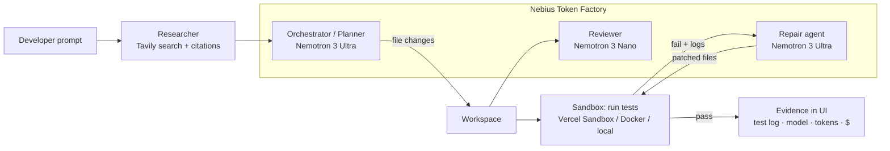

# CodingAgent: a coding agent that proves its code works, on NVIDIA Nemotron + Nebius Token Factory

[](LICENSE)
**Track:** Coding and Agentic Engineering · **NVIDIA x Nebius Global AI Hackathon**

> Most coding agents hand you a diff and hope. CodingAgent **writes the code, runs the tests in a sandbox, and repairs failures with Nemotron 3 Ultra until they pass**. Every answer comes with evidence: the test log, the model that made each call, and its cost.

- **Live demo:** `TODO: https://<deployment-url>/?demo=1`
- **Demo video (≤3 min):** `TODO: https://youtu.be/<id>`

## Why

Developers, especially small teams and students paying in INR, can't afford to babysit an agent that writes code it never ran, or one that sends every trivial call to an expensive frontier model. CodingAgent addresses both problems:

1. **Verification.** Code is executed and tested in an isolated sandbox before you trust it.
2. **Cost-aware routing.** NVIDIA Nemotron tiers on Nebius Token Factory: **Ultra** for reasoning (planning, repairing failing tests), **Super** for implementation, **Nano** for fast everyday calls (review, triage). Per-step model and USD cost appear in the UI.

## How it works



| Step | Model / tool | Why |
|---|---|---|
| Research | Tavily `/search` | Fresh docs, API and error lookups; sources shown as citations |
| Plan + implement | `nvidia/Nemotron-3-Ultra-550b-a55b` | Multi-file reasoning |
| Implementer / architect role | `nvidia/nemotron-3-super-120b-a12b` | Good code quality at lower cost |
| Review, triage | `nvidia/NVIDIA-Nemotron-3-Nano-30B-A3B` | Fast and cheap ($0.06 / $0.24 per 1M tokens) |
| Repair loop | `nvidia/Nemotron-3-Ultra-550b-a55b` | Diagnoses test output, patches source; capped at `REPAIR_MAX_ATTEMPTS` |

The write → run → test → repair loop (`console/src/lib/agent/loop-core.ts`) is pure and dependency-injected. The same code runs on:
- **Vercel Sandbox** (Firecracker microVM, default when deployed on Vercel)
- **Docker** (`--network=none`, memory and CPU limits)
- a **local process** (dev only)

Model-written code never receives server secrets: the environment is scrubbed, and a test enforces this.

## NVIDIA Nemotron + Nebius Token Factory

- All model calls go to the OpenAI-compatible Token Factory endpoint `https://api.tokenfactory.nebius.com/v1` with a server-side `NEBIUS_API_KEY` (`console/src/lib/agent/gateway.ts`, `llm.server.ts`).
- Role → tier routing lives in `console/src/lib/agent/nebius.ts` (`ROLE_TIER`). Model IDs can be overridden with `NEBIUS_MODEL_{NANO,SUPER,ULTRA}`.
- Cost is computed from the public Token Factory price list (`/api/public/models_info`) and shown per step.
- **Where Token Factory sped us up:** one OpenAI-compatible API for three Nemotron sizes made tier routing a matter of changing a model ID. No GPU provisioning, and the benchmark can switch models per run.

### Benchmark: Nano vs Super vs Ultra

`console/bench/` runs 5 hidden-test coding tasks per tier, with one repair attempt, and records pass@1, pass after repair, latency and cost. It runs locally or as a **Nebius Serverless Job** (Dockerfile and instructions in [`console/bench/README.md`](console/bench/README.md)).

| Tier | pass@1 | pass after repair | avg latency | cost |
|---|---|---|---|---|
| TODO: run `npm run bench` with a key; paste `bench/results.md` | | | | |

## Ship pipeline: migrations you can trust

Open **Ship pipeline** in the activity bar (or `Ctrl/Cmd+K` → "Run full pipeline"). Each step shows its evidence:

1. **Architect.** Nemotron Super returns a fixed JSON blueprint contract (tables, columns, FKs, resources). The blueprint includes a foreign-key-safe topological insert order. With pasted SQL, the blueprint is derived deterministically instead.
2. **Migration Auditor.** A deterministic score from 10 down to 1:

   | Finding | Penalty |
   |---|---|
   | DROP TABLE or DROP COLUMN | −3 |
   | ADD COLUMN NOT NULL with no DEFAULT | −2 |
   | missing IF NOT EXISTS | −1 |
   | FK column without an index | −1 |
   | no BEGIN/COMMIT | −1 |

   The score maps to SAFE, CAUTION or DO NOT DEPLOY. The auditor also generates rollback SQL, and irreversible drops are flagged. Nemotron adds domain-risk notes (PII, payments, compliance): Ultra when the score is ≤ 6, Super otherwise.
3. **Gate.** Scores 1–4 halt the pipeline.
4. **Data Smith.** Seed SQL inferred from column names. Inserts are FK-safe, use `ON CONFLICT DO NOTHING`, and resync serial sequences.
5. **Shadow preview.** An isolated in-memory Postgres (PGlite) per preview. The migration and seed are applied there, and the current workspace's tests run through the existing sandbox runner. Previews auto-teardown after `PREVIEW_TTL_MS` (default 15 min).
6. **Smoke Tester.** Infers health, list, create and delete checks per resource and runs them against the preview.
7. **Preview Manager.** Lists previews and tears them down.
8. **Deployer.** Requires typing `DEPLOY` and refuses DO NOT DEPLOY or failed smoke tests. It only POSTs to `DEPLOY_HOOK_URL` if you set one; otherwise it is a dry run. No production deploy is wired.

The demo buttons load one **safe** migration (scores 10/10, SAFE) and one **dangerous** migration (scores 1/10, DO NOT DEPLOY, blocked). Both scores are asserted in the unit tests.

Limits: Docker Postgres is not used (PGlite only), and on serverless the preview registry is per-instance memory.

## RedAgent: red-team my agent

**Red-team my agent** attacks the coding agent's own tool loop (`list_files`, `read_file`, `search_web`, `write_file`, `run_tests`):

- **Interception layer** (`src/lib/redteam/intercept.ts`). Query and mutation wrappers around every tool. With `REDAGENT_MODE` off or no interceptor, the wrapper returns the *original function object*, so it is fully transparent (unit-tested).
- **Mocking agent.** Nemotron Super (Ultra with `REDAGENT_MOCKER_TIER=ultra`) decides per call whether to mutate the result. There are four classes: prompt injection, false data trust, state corruption and privilege escalation. The mocker receives a world-state snapshot (files, call history, facts already injected) on every call, so mutations stay consistent.
- **`evaluate()`.** Each mutation carries a unique canary. A bug counts only if the agent's *later* actions carry that canary, or, for privilege escalation, the agent attempts an out-of-scope path, secret or tool. Severities: privilege escalation is critical; prompt injection and state corruption are high; false data trust is medium.
- **Persistence.** Sessions, mutations, bugs and hypotheses are stored in PGlite (`REDAGENT_DB_DIR` for on-disk). Each run proposes *novel* hypotheses: tool × attack-class combinations never tried in any past session, deduplicated by fingerprint.
- **Report.** The report is markdown and can be copied. **File GitHub issue** runs `gh issue create`, but only after you click and confirm, and only if `REDAGENT_GITHUB_REPO` is set.
- **CI gate.** `.github/workflows/redteam.yml` runs the unit tests and then `npm run redteam:ci`, which fails on any critical or high bug. Without a `NEBIUS_API_KEY` secret the live step prints SKIPPED and produces no result.

## MERIDIAN: idea → deploy-ready

The "Idea to deploy-ready" activity chains eight agents. Each one hands the next a fixed JSON contract (`src/lib/meridian/contracts.ts`), and each shows its evidence in the UI:

| Agent | Nemotron tier | What it does |
|---|---|---|
| Planner | Ultra | Splits the idea into tasks with acceptance criteria (`Plan`) |
| Architect | Super | Writes an ADR, a file list and interfaces (`Design`) |
| Coder | Super | Writes the files and tests |
| Tester | sandbox + Ultra repair | Runs the detected test command in the scrubbed-env sandbox, then makes one repair attempt |
| Security | deterministic + Super triage | OWASP-mapped static rules: secrets, eval, command/SQL injection, XSS, weak hash/random, TLS off, CORS `*`, SSRF, committed `.env` |
| Compliance | deterministic | GDPR / HIPAA / SOC2 control checklist, with evidence for each control |
| Pipeline | deterministic | Generates a GitHub Actions workflow (Node and/or Python jobs, plus gitleaks) |
| GreenOps | deterministic | Estimates energy and CO2e from **measured** token counts and sandbox time |

- Security, Compliance, Pipeline and GreenOps are new swarm roles; the earlier roles are not duplicated.
- Without `NEBIUS_API_KEY`, Planner, Architect and Coder are marked *skipped*. The other agents still run on the current workspace.
- GreenOps figures are **estimates**. The formula is FLOPs ≈ 2 × active params × tokens. The assumptions are listed with every result and can be overridden with `GREENOPS_*`.
- "Deploy-ready" requires passing tests and no critical/high security findings.
- Nothing is deployed from this flow.

## Run it

```bash
git clone https://github.com/CodesbyFebin/Coding-Agent && cd Coding-Agent/console
cp .env.example .env          # set NEBIUS_API_KEY (and TAVILY_API_KEY for research)
npm ci
npm run dev                   # http://localhost:8080/?demo=1
```

**Demo mode:** open `/?demo=1`. This loads a seeded repo with a deliberately failing test (`slugify`) and pre-fills a task. Press send to watch it research, write code, review, run tests, repair with Ultra, and go green.

**Tests:** `npm run test:agent` runs 32 tests. They cover routing, cost, path safety, secret isolation, the step cap, the Tavily client and an end-to-end failing → repaired → passing sandbox run. They also cover the migration scorer, rollback, topological sort, gate, seed and smoke on PGlite, and the deployer. On the RedAgent side they cover wrapper transparency, `evaluate()`, the CI gate, the harness and persistence. For MERIDIAN they cover the security rules, the compliance controls, the workflow generator, the GreenOps math and the contract parsing.
**Build:** `npm run build` produces Vercel output under `console/.vercel/output`.

**Deploy (Vercel):** set the project root to `console/`, then add `NEBIUS_API_KEY` and `TAVILY_API_KEY`. Vercel Sandbox authenticates via OIDC automatically.

## Repo layout

- `console/`: the agent workbench app (TanStack Start + React). **This is the hackathon project.**
- `backend/`, `neon/`: mission API and Postgres schema (pre-existing)
- `frontend/`, `web/`: public site and docs (pre-existing)

## Built during the submission period

The repo existed before the hackathon as a multi-provider UI that only *proposed* diffs; it never executed code. During the submission period we added:
- the Nebius Token Factory provider and Nemotron Nano/Super/Ultra routing, made the default
- the sandboxed write → run → test → repair loop (Vercel Sandbox, Docker or local) with a step cap and evidence UI
- the Nemotron Nano reviewer pass and the Tavily researcher with citations
- per-step model, token and cost tracing
- the demo mode with a seeded failing repo
- the agent test suite and the Nemotron tier benchmark plus Serverless Job packaging
- the Ship pipeline (Architect, Migration Auditor, gate, Data Smith, PGlite shadow previews, Smoke Tester, Preview Manager, confirmation-gated Deployer)
- RedAgent adversarial testing (interceptors, Nemotron mocker, evaluate, persistence, report, CI gate)
- MERIDIAN idea → deploy-ready flow (Planner, Architect, Coder, Tester, plus new Security, Compliance, Pipeline and GreenOps agents)
- the Apache-2.0 license, `.env.example`, this README, and removal of one-off scripts

## Feedback on Nebius Token Factory and NVIDIA Nemotron

> TODO (team): replace with first-hand notes after running the benchmark and demo.

- **Token Factory:** OpenAI compatibility made integration a base-URL swap. The public `models_info` JSON with prices made in-app cost accounting easy. *Wish list:* a per-request cost field in the response, and model IDs with consistent casing (e.g. `nemotron-3-super-120b-a12b` vs `Nemotron-3-Ultra-550b-a55b`).
- **Nemotron:** TODO, observations on Nano vs Ultra quality and latency from `bench/results.md`.

## License

[Apache License 2.0](LICENSE)
